# Juegos en la tele: cómo funcionan y cómo los construimos

*Escuela Industrial Nº4 “José Menéndez” · 5ºI Informática · 2026*

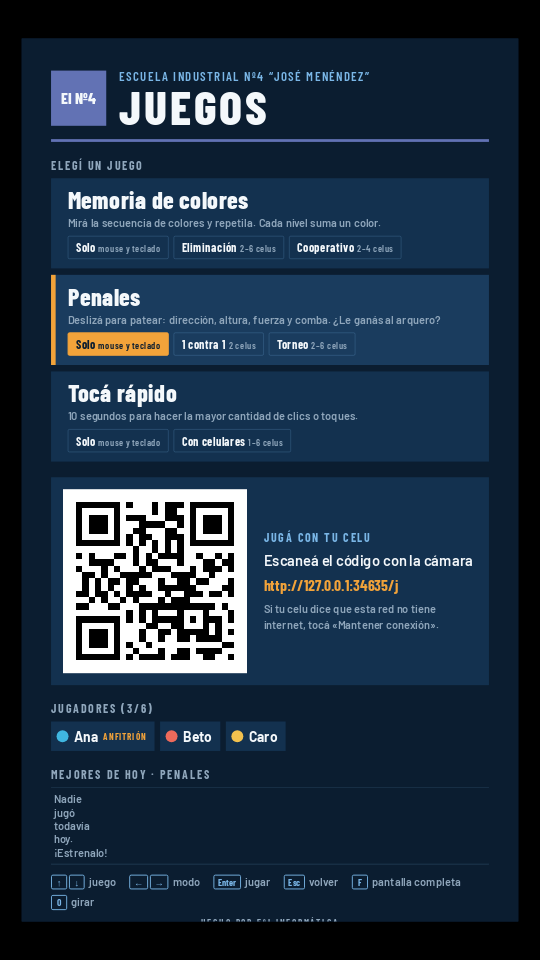

## 1. Qué es

**Juegos en la tele** es una plataforma de juegos para un televisor puesto **en vertical** (de pie). La imagen mide 1080 píxeles de ancho por 1920 de alto. La tele **no es táctil**: está conectada por HDMI a una notebook, y **cada jugador usa su propio celular como control**. Escanea el código QR que aparece en la pantalla, escribe su nombre y juega desde el celu.

Trae tres juegos:

- **Memoria de colores**, del estilo de «Simón dice».
- **Penales**.
- **Tocá rápido**, un juego corto que usamos de ejemplo y para probar la plataforma.

Todo funciona **sin internet**, en una red local que se arma con la zona wifi de un celular. Si se cae el wifi, cada juego tiene un **modo Solo** que se juega en la tele con el mouse y el teclado.

Es el segundo proyecto de este tipo que hicimos. El primero fue el **Bowling Tótem**, que tiene su propio documento: `bowling-totem/COMO-FUNCIONA.md`. De ese proyecto reutilizamos la forma de conectar los celulares, el ranking, el diseño y el logo de la escuela. En la sección 15 están las diferencias.

## 2. Los juegos

### 2.1 Memoria de colores

En el centro de la pantalla hay **4 botones grandes de colores**. Cada uno tiene un símbolo (● ▲ ■ ★) y una nota musical distinta. El juego muestra una secuencia encendiendo los botones y hay que repetirla en el mismo orden. En cada nivel la secuencia suma un color, y hay **3 segundos por color** para responder; si se acaba el tiempo, cuenta como error.

La dificultad va subiendo:

| Nivel | Qué cambia |
|---|---|
| 5 | Más rápido: cada color se muestra 450 ms en vez de 600 ms |
| 8 | Después de mostrar la secuencia, **los botones cambian de lugar** |
| 10 | **6 colores** en vez de 4, en una grilla de 2 × 3 |
| 13 | Velocidad máxima: 320 ms por color |
| 6, 12, 18… | **Ronda especial**, anunciada con un cartel 2 segundos antes. Se alternan «**al revés**» (repetir de atrás para adelante) y «**trampa**» (aparece la palabra ROJO escrita en azul y hay que tocar el color de la letra) |

| Se muestra la secuencia | Ronda especial «al revés» | Ronda «trampa» con 6 colores |
|---|---|---|
| 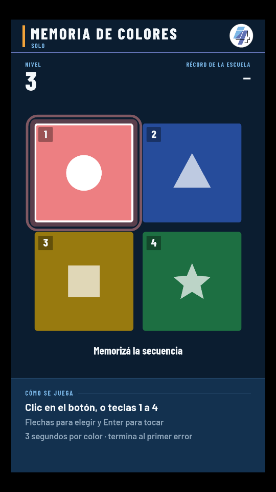 | 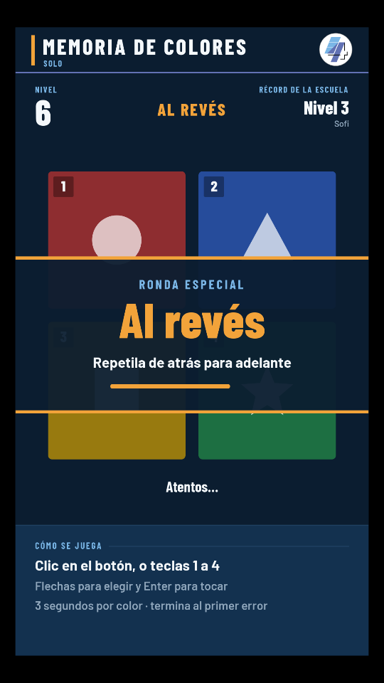 | 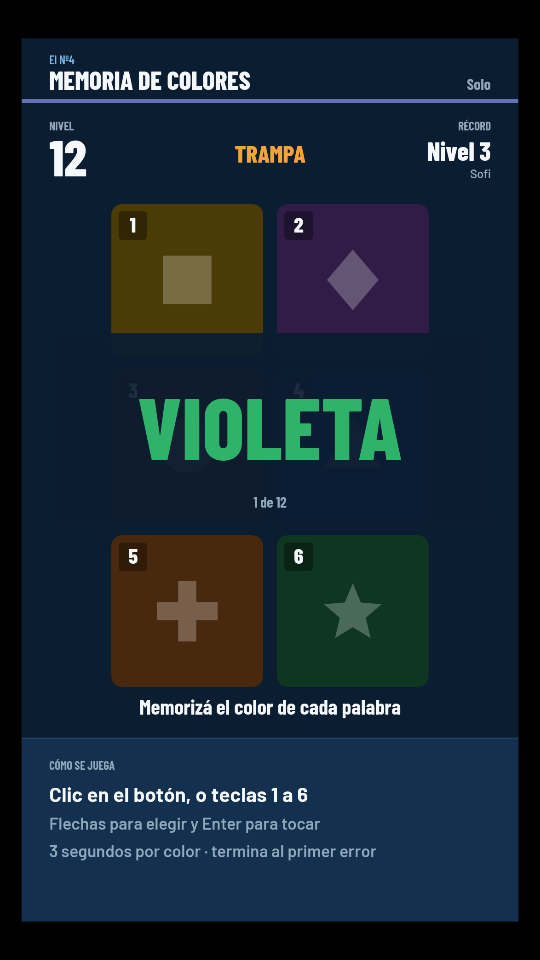 |

**Modos:**
- **Solo:** con el celu, o con el mouse y las teclas 1 a 6. Termina al primer error.
- **Eliminación** (2 a 6 celulares): todos ven la secuencia en la tele (el celu **no** la muestra) y la repiten en su celu. Quien se equivoca queda afuera; el último que queda gana.
- **Cooperativo** (2 a 4 celulares): los colores se reparten entre los celulares y el grupo repite la secuencia entre todos, cada uno tocando cuando le toca su color. Tienen 3 vidas en total.

**Puntaje:** nivel alcanzado × 100 + un bonus por responder rápido. El bonus tiene un tope de 99, así que un nivel más siempre vale más que cualquier bonus.

### 2.2 Penales

Arriba de la pantalla están el arco con su red y el arquero; abajo, la pelota en el punto penal. Todo está dibujado a mano con código, en una perspectiva simple: no hay ninguna imagen.

Se patea **deslizando el dedo** en el celu, desde la pelota hacia el arco (en el modo Solo también se puede arrastrar con el mouse):

| Del trazo… | …sale |
|---|---|
| La **dirección** | Para qué lado va la pelota |
| El **largo** hacia arriba | La **altura** del tiro |
| La **velocidad** | La **fuerza** (con demasiada fuerza, el tiro sube y se va por arriba) |
| La **curva** | La **comba**: la pelota dobla |

| Tiro en el aire | ¡GOOOL! | El celu del pateador (con reloj) | El celu del arquero |
|---|---|---|---|
| 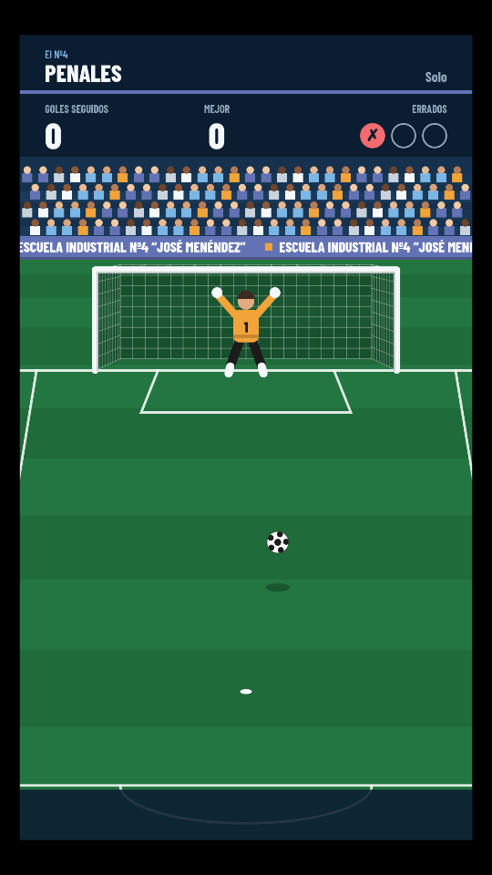 | 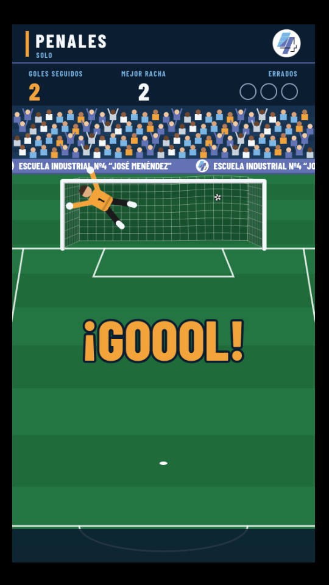 | 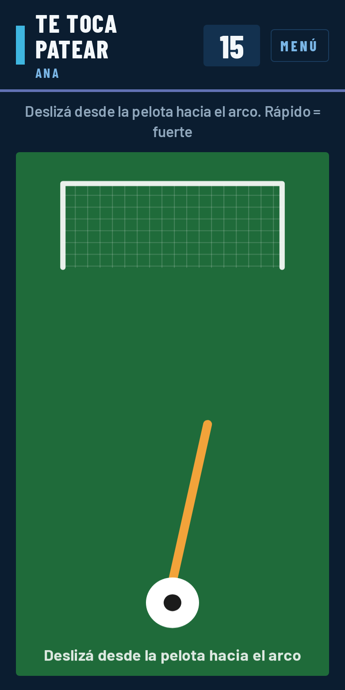 | 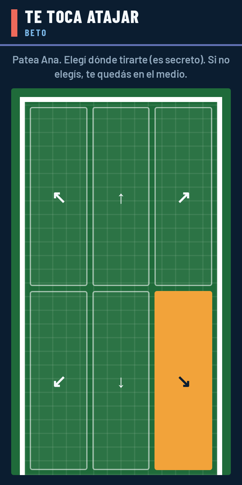 |

El arco se divide en **6 zonas** (3 columnas × 2 alturas). Si el arquero se tira a la zona del tiro, ataja. La excepción es un tiro **muy fuerte y muy pegado al palo**: es un golazo imposible de atajar. Si la pelota pega justo en el borde, sale «¡PALO!» con rebote.

**Modos:**
- **Solo** (celu o mouse): contra un arquero automático, hasta errar 3. Cuenta los goles seguidos.
- **1 contra 1** (2 celulares): uno patea con el control de deslizar y el otro ataja eligiendo una zona en una grilla de 3 × 2. El arquero elige **en secreto** durante los 3 segundos de carrera del pateador; si no elige, se queda en el medio. Patean 5 penales cada uno, alternando roles, y si empatan sigue con muerte súbita.
- **Torneo** (2 a 6 celulares): cada uno patea 5 penales contra el arquero automático, por turnos. Gana el que mete más; si empatan, desempata la precisión.
- Si el pateador no tira en 15 segundos, sale un tiro débil al centro.

### 2.3 Tocá rápido

Hay 10 segundos para tocar el botón del celu (o hacer clic) la mayor cantidad de veces posible. Lo usamos como **juego de ejemplo**: es el más simple, y con él probamos que la plataforma funcionaba antes de hacer los otros dos.

## 3. Cómo está armado

El sistema tiene **tres partes** que se comunican por la red local:

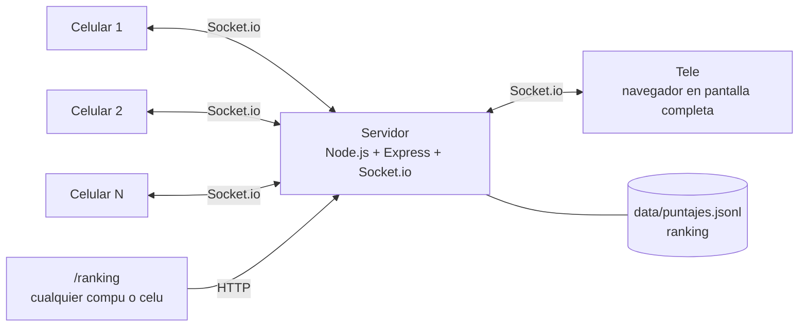

- **El servidor** (`server.js`) corre en la notebook. Sirve las páginas, arma el QR, maneja la **sala** (quién está conectado y quién es el anfitrión), reenvía los mensajes entre los celulares y la tele, y guarda los puntajes. **No corre los juegos.**
- **La tele** (`public/tele/`) es una página web abierta en el navegador en modo kiosco (pantalla completa, sin barras). Es **la autoridad del juego**: ahí corren las reglas, los turnos y el puntaje, y ahí se dibuja todo.
- **Los celulares** (`public/j/`) muestran el control que les pide el juego (botones, una grilla, una zona para deslizar o un mensaje de espera) y mandan lo que toca el jugador.

Decidimos que la tele sea la autoridad, como en el bowling, porque las animaciones corren a 60 cuadros por segundo pegadas al dibujo. El servidor queda simple: solo hace de cartero. La única regla que corre en el servidor es la del **cooperativo de Memoria** (sección 9).

## 4. Lenguajes y tecnologías

Todo el proyecto está hecho con **tecnologías web** y un solo lenguaje de programación, **JavaScript**: en el servidor con Node.js y en los navegadores de la tele y de los celulares. No usamos frameworks de interfaz (como React) ni motores de juego: las pantallas están escritas a mano con HTML, CSS y JavaScript, y los juegos se dibujan en un `<canvas>`.

| Tecnología | Versión | Para qué la usamos |
|---|---|---|
| **JavaScript** | Node.js 24 y navegador | Toda la lógica: servidor, plataforma, juegos, control del celular, ranking |
| **HTML5** | — | La estructura de las páginas: la tele, el celular y el ranking |
| **CSS3** | — | El diseño del menú, de los resultados, del celular y del ranking. Usamos variables de color, flexbox y grid. La rotación de la pantalla es una transformación CSS |
| **Canvas 2D** | — | El dibujo de los juegos: botones con brillo y ondas, la cancha, el arco, la red, el arquero, la hinchada, la pelota |
| **SVG** | — | El emblema de la escuela, redibujado en vector, y los símbolos de los botones en el celu |
| **Express** | 5.3.0 | El servidor web: páginas, la lista de juegos, el QR y la API del ranking |
| **Socket.io** | 4.8.4 | Comunicación en tiempo real (WebSockets) entre celulares, servidor y tele |
| **qrcode** | 1.5.4 | Genera el código QR en el propio servidor, así no hace falta internet |
| **Barlow** y **Barlow Condensed** | Fontsource 5 | Las tipografías, incluidas en el proyecto para que anden sin conexión |
| **Web Audio API** | — | Todos los sonidos se **sintetizan** en el momento: no hay archivos de audio |
| **Pointer Events, Vibration, localStorage** | — | En el celular: el gesto del dedo, la vibración al tocar y recordar al jugador para reconectarlo |
| **JSON Lines** | — | El formato del archivo de puntajes: un JSON por renglón |
| **node:test** y **Playwright** | Node 24 · 1.49.1 | Pruebas automáticas: unitarias, y con navegadores reales que emulan la tele y los celulares |
| **Bash** y **Batch** | — | Los lanzadores con doble clic: `iniciar.sh` en Linux e `iniciar.bat` en Windows |

En números, son unas **5.000 líneas** de código y unas **1.700 líneas** de pruebas:

| Parte | Líneas |
|---|---|
| Servidor y ranking | ≈ 850 |
| Plataforma de la tele | ≈ 1.040 |
| Celular | ≈ 530 |
| Código compartido | ≈ 380 |
| Página de ranking | ≈ 120 |
| Memoria | ≈ 1.000 |
| Penales | ≈ 990 |
| Tocá rápido | ≈ 160 |

## 5. Estructura del proyecto

```
juegos-tele/
├── server.js             servidor: páginas, sala de jugadores, mensajes, QR, puntajes
├── leaderboard.js        guardar y consultar puntajes, filtro de nombres, copias de seguridad
├── config.json           escuela, colores, logo, puerto, rotación, colores de Memoria, dificultad
├── iniciar.sh / .bat     arrancan todo con doble clic
├── data/                 puntajes (se crea solo)
├── public/
│   ├── tele/             la plataforma: escala, rotación, menú, resultados, teclado en pantalla
│   ├── j/                el celular: entrar, sala, controles
│   ├── ranking/          tablas de Hoy, Semana y Siempre
│   ├── shared/           tipografías, sonidos, análisis del trazo, símbolos, ayudas de dibujo, emblema
│   └── juegos/
│       ├── memoria/      juego.json, logica.js (reglas), juego.js (dibujo), servidor.js (cooperativo)
│       ├── penales/      juego.json, logica.js (reglas), juego.js (dibujo)
│       └── toca-rapido/  juego.json, juego.js
└── test/                 pruebas automáticas y la simulación de penales
```

En cada juego separamos las **reglas** (`logica.js`) del **dibujo** (`juego.js`). Las reglas no usan nada del navegador, así que se pueden probar en Node sin abrir ninguna pantalla, y la misma `logica.js` la usan la tele, el servidor y las pruebas.

## 6. Una plataforma para muchos juegos

En lugar de hacer tres programas separados, hicimos **una plataforma** y los juegos se enchufan en ella. La plataforma se ocupa de todo lo que es común:

- el menú;
- el QR y la sala de jugadores;
- escalar y girar la pantalla;
- el mouse y el teclado;
- los controles del celular;
- los resultados y el ranking;
- el teclado en pantalla para el nombre en el modo Solo.

Cada juego es una carpeta en `public/juegos/<id>/` con un archivo `juego.json`, que dice el nombre, los modos y las tablas del ranking. El servidor lee esas carpetas solo, así que **para agregar un juego no hay que tocar nada más**. El código del juego se registra así:

```js
Plataforma.registrar('memoria', () => ({
  iniciar(contexto, jugadores, modo) { … },    // empieza la partida
  recibirInput(jugadorId, datos, ts) { … },     // un celu tocó algo
  puntero(x, y, tipo) { … },                    // el mouse en la tele
  tecla(codigo) { … },                          // el teclado de la tele
  actualizar(dt) { … },                         // avanza el juego dt segundos
  dibujar(ctx) { … },                           // dibuja el cuadro en el canvas
  controlCelular(jugadorId) { … },              // qué tiene que mostrar ese celu
  terminado() { … },                            // ¿terminó la partida?
  resultados() { … },                           // puntajes para mostrar y guardar
}));
```

Los juegos le piden al celular uno de cuatro **controles**:

- **botones:** botones de colores, para Memoria y Tocá rápido;
- **zonas:** una grilla de N botones, como el arco del arquero;
- **deslizar:** un trazo con dirección, fuerza y curva, para patear;
- **espera:** un mensaje, por ejemplo «Mirá la tele y memorizá».

Así el celular no sabe a qué se está jugando: solo dibuja lo que le piden. Todo esto está explicado en detalle en `JUEGOS.md`.

## 7. La comunicación en tiempo real

Los celulares y la tele están conectados todo el tiempo al servidor con **WebSockets** (mediante Socket.io), una conexión que queda abierta y permite mandar mensajes en las dos direcciones al instante. Estos son los mensajes principales:

| Mensaje | De → a | Qué lleva |
|---|---|---|
| `jugador:unirse` | celular → servidor | El nombre y un *token* para poder reconectarse |
| `sala` | servidor → todos | La lista de jugadores, quién es el anfitrión y qué se está jugando |
| `anfitrion:accion` | celular del anfitrión → tele | Qué juego y modo eligió, «Jugar otra vez» o «Volver al menú» |
| `tele:control` | tele → celular | Qué control mostrar: botones, zonas, deslizar o espera |
| `jugador:input` | celular → tele | Lo que tocó: un botón, una zona o un trazo, con la hora del toque |
| `tele:puntajes` | tele → servidor | Los puntajes finales, para guardarlos |
| `reloj` | celular ↔ servidor | Para sincronizar la hora del celu con la de la notebook |

El servidor **no confía** en lo que le mandan:
- Valida los nombres: de 2 a 14 letras o números, y un filtro de malas palabras que se puede editar.
- Limita cuántos mensajes por segundo puede mandar cada celu y de qué tamaño.
- Solo la tele puede guardar puntajes. Además, **el nombre de cada puntaje lo pone el servidor** a partir del id del jugador, así nadie puede inventar un nombre.
- Cada partida tiene un id, así que si un puntaje llega dos veces no se guarda dos veces.
- Si un celular pierde la conexión y vuelve, por ejemplo porque se bloqueó la pantalla, recupera su lugar gracias al *token* que guardó en el navegador.

## 8. La tele por dentro

### Escalar y girar la pantalla

Los juegos siempre se dibujan en un lienzo fijo de 1080 × 1920. La plataforma lo agranda o achica para que entre en la ventana sin deformarse, igual que el bowling: escala = el menor entre ancho disponible / 1080 y alto disponible / 1920.

Si la notebook no puede girar la pantalla desde el sistema, el juego la gira solo con CSS (`rotate(90deg)`), con la opción `rotarPantalla` o con la tecla O. Lo difícil fue que **el mouse siga cayendo en el lugar correcto** con la imagen girada. Para eso, a cada clic le aplicamos la transformación inversa: lo giramos –90° alrededor del centro y lo dividimos por la escala. Así el juego recibe coordenadas del lienzo de 1080 × 1920 aunque la pantalla esté girada.

### El bucle del juego

Usamos `requestAnimationFrame`, que el navegador llama unas 60 veces por segundo. En cada cuadro, la plataforma le pide al juego que se actualice según el tiempo que pasó (`dt`) y que se dibuje, y después pregunta si terminó. Si un juego tira un error, la tele no se congela: el bucle siempre pide el cuadro siguiente primero.

### El dibujo y el rendimiento

Todo se dibuja con la API de Canvas 2D: rectángulos, arcos, curvas de Bézier y texto. Aprendimos del bowling que **redibujar todo el lienzo en cada cuadro** es lento en notebooks sin placa de video. Por eso:

- Lo que casi no cambia (la cancha, el arco, los carteles, el encabezado, la tribuna) se dibuja una vez en un **canvas en memoria** y después se copia entero.
- No usamos sombras de canvas (`shadowBlur`), que son muy caras. El brillo de los botones es un rectángulo más grande y semitransparente.
- La pantalla que tiembla con el gol se hace con una animación CSS, no redibujando.

### El sonido

No hay archivos de audio: todo se genera con la **Web Audio API**.
- En Memoria, cada color tiene una nota: Mi, La, Do#, Mi, Sol y La, que son las notas del Simón clásico más dos.
- La patada es un tono grave que baja rápido.
- La red, la hinchada y el silbato combinan ruido filtrado con tonos agudos.

## 9. Memoria por dentro

- **La secuencia** se arma con un generador de números al azar con **semilla** (algoritmo *xorshift*). En las pruebas usamos siempre la misma semilla, así una partida se puede repetir exactamente igual. Además, nunca sale el mismo color tres veces seguidas.
- **Responder:** por cada jugador guardamos qué color le toca, a qué hora tocó el anterior y su bonus. Cada toque devuelve «bien», «completo», «error» o «tiempo».
- **Mezcla:** a partir del nivel 8, los botones se mezclan de modo que **ninguno quede en su lugar**, y la mezcla se anima con los botones volando a su nuevo lugar.
- **Eliminación:** cada jugador responde en su celu con su propio reloj. Si un celu se desconecta, se le acaba el tiempo y queda afuera; el juego sigue sin trabarse.

**Cooperativo validado en el servidor.** En el cooperativo, varios celus tocan en orden y los mensajes llegan por wifi, cada uno con un retraso distinto. Si validáramos por **orden de llegada**, un celu con mala señal podía hacer perder al grupo aunque hubiera tocado a tiempo. Lo resolvimos así:

1. Al conectarse, cada celu **sincroniza su reloj** con el de la notebook. Hace 5 preguntas de «¿qué hora es?» y se queda con la de menor demora.
2. Cada toque viaja con **la hora en que se tocó**.
3. El servidor junta los toques durante 120 ms, **los ordena por esa hora** y recién ahí los valida.

## 10. Penales por dentro

### Del trazo al tiro

El dedo deja una lista de puntos con su posición y su hora. El análisis (`shared/trazo.js`) calcula cuatro valores:

- **la subida:** cuánto subió el dedo;
- **el ángulo:** respecto de la vertical;
- **la velocidad:** el recorrido del último 60% del trazo dividido por el tiempo que llevó;
- **la curva:** cuánto se aparta el medio del trazo de la línea recta.

Con eso se calcula a qué punto del arco va la pelota: x de –1 a 1 entre los palos, y de 0 a 1 entre el piso y el travesaño. A esos valores se les suma un pequeño **error humano al azar**.

Hay dos calibraciones, porque no es lo mismo deslizar en un celu que arrastrar el mouse en una pantalla grande. Con el mouse, arrastrar desde la pelota hasta el palo hace que la pelota pegue en el palo.

> **Un problema que encontramos:** al principio la fuerza se medía solo con los últimos 140 milisegundos del trazo, y en las pruebas automáticas salía casi siempre 0. Descubrimos dos cosas. El navegador entrega un movimiento por cuadro (cada 17 ms), a destiempo. Y al soltar el dedo, el último punto se repite sin moverse, lo que «frena» la medición. Cambiamos el cálculo para que use el último 60% del recorrido e ignore esa pausa corta al soltar. Así es más estable también con dedos reales.

### ¿Gol, atajada, afuera o palo?

Con el punto del arco y la zona del arquero, las reglas (`penales/logica.js`) deciden en este orden:

1. Si la pelota pasa más allá de los palos o del travesaño: **afuera**.
2. Si cae justo en el borde: **palo**.
3. Si el arquero eligió esa zona: **atajada**, salvo que sea un tiro muy fuerte (fuerza ≥ 0,8) y muy pegado al palo: **golazo**.
4. Si el tiro es muy flojo, el arquero llega aunque se haya tirado a otra altura.

El **arquero automático** elige una zona al azar, pero con más probabilidad las zonas donde ese jugador ya pateó: aprende su tendencia. Según la dificultad, a veces «lee» el tiro.

### Calibrar con una simulación

Para que el juego no fuera ni muy fácil ni imposible, escribimos una **simulación** que patea 1000 tiros al azar y 1000 tiros «buenos» (bien apuntados, con fuerza media) contra el arquero automático. Fuimos ajustando el arquero hasta que un tiro bueno, en dificultad normal, fuera gol entre el **60% y el 75%** de las veces:

| Dificultad | Tiros | Gol | Atajada | Afuera | Palo |
|---|---|---|---|---|---|
| Fácil | buenos | 80,8% | 16,1% | 0,5% | 2,6% |
| **Normal** | **buenos** | **65,1%** | 33,2% | 0,2% | 1,5% |
| Difícil | buenos | 55,4% | 41,4% | 0,7% | 2,5% |
| Normal | al azar | 15,9% | 10,5% | 69,3% | 4,3% |

Lo probamos con 10 semillas distintas y el promedio dio 67%. Se puede volver a correr con `npm run sim`.

### La presentación

- La pelota sigue una **curva de Bézier**: con comba, el punto de control se corre para el otro lado y la pelota «dobla». Además gira y se achica a medida que se aleja.
- El arquero se tira con una animación que lo rota hacia su zona.
- Con el gol, la red se deforma con una onda que se va apagando.
- En los tiros pegados al palo hay **cámara lenta**: el tiempo pasa al 30%.
- La hinchada salta en el gol: se alternan tres versiones de la tribuna ya dibujadas.
- Los carteles de la cancha llevan el emblema y el nombre de la escuela, y las camisetas tienen los colores de `config.json`.

## 11. El celular por dentro

El celular no necesita instalar nada: es una **página web** que se abre con el QR.

| Entrar | El anfitrión elige el juego | Memoria en el celu | Esperar el turno |
|---|---|---|---|
| 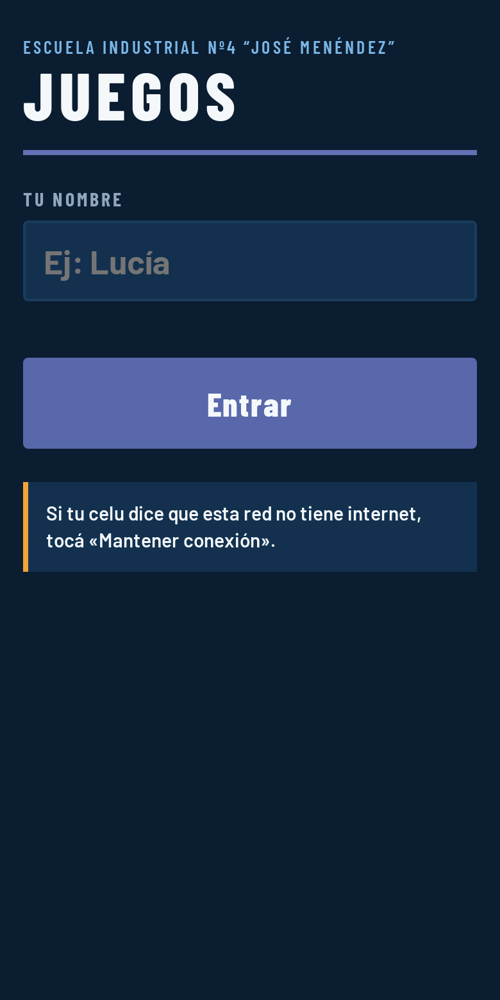 | 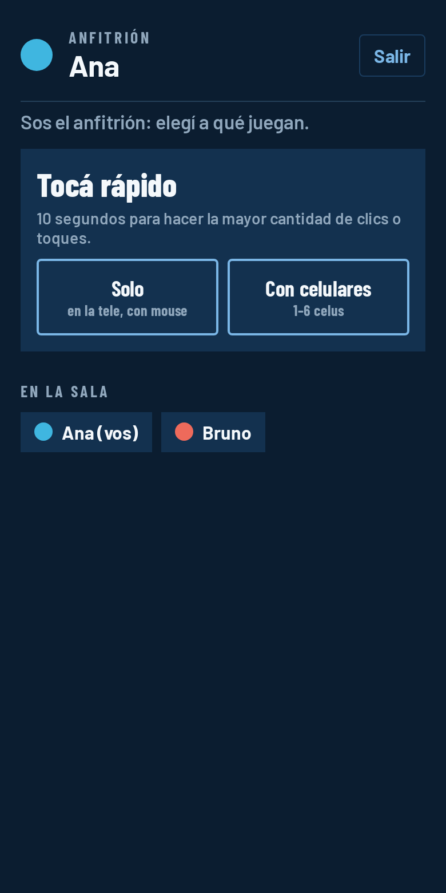 | 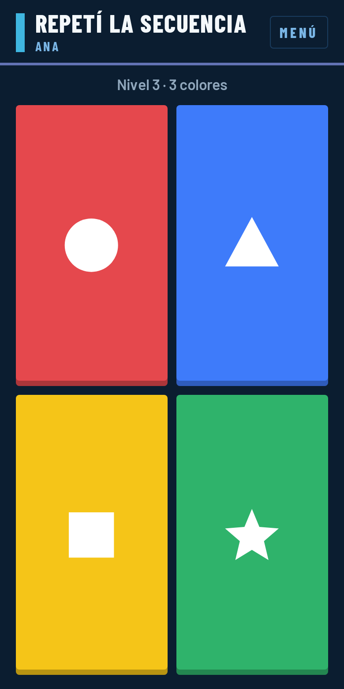 | 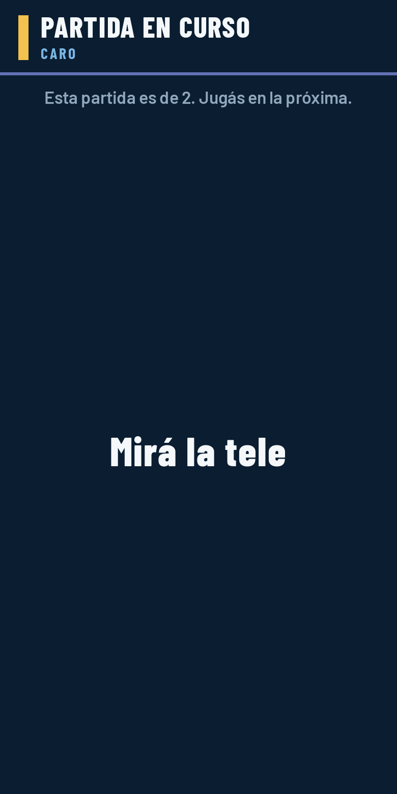 |

- El **primero que entra es el anfitrión**: elige el juego y el modo desde su celu. Si elige **Solo**, juega él con su celu, como en el bowling.
- Usamos **Pointer Events**, que funcionan igual con el dedo y con el mouse. En la zona de deslizar, el trazo se dibuja en un canvas mientras se mueve el dedo.
- Durante los turnos con tiempo, el celu muestra un **reloj** que se pone naranja en los últimos 5 segundos. Usa la hora sincronizada, así coincide con la de la tele.
- El celu **vibra** al tocar, y guarda un *token* en el navegador (`localStorage`) para volver solo a su lugar si se corta la conexión.
- Como la red no tiene internet, el celu puede avisar «Esta red no tiene acceso a internet». Por eso la tele y el celu explican que hay que tocar **«Mantener conexión»**.

## 12. El ranking y los datos

- Cada puntaje se guarda como un renglón JSON en `data/puntajes.jsonl`, con nombre, juego, modo y fecha. **Solo se agrega al final, nunca se borra.** Si se corta la luz justo cuando se escribía un renglón, al leer el archivo ese renglón cortado se ignora y lo demás sigue sano.
- Una vez por día se guarda una copia en `data/backups/`.
- Cada juego tiene sus tablas:
  - Memoria: mejor nivel individual y mejor nivel en equipo.
  - Penales: goles seguidos, ganadores de torneo y efectividad como arquero (con un mínimo de 5 tiros).
  - Tocá rápido: más toques.
- Cada tabla se ve como **Hoy**, **Semana** y **Siempre**, con la hora de Argentina.
- En la tele, el ranking rota solo entre las tablas. También se ve en `/ranking` desde cualquier celu o compu de la red.

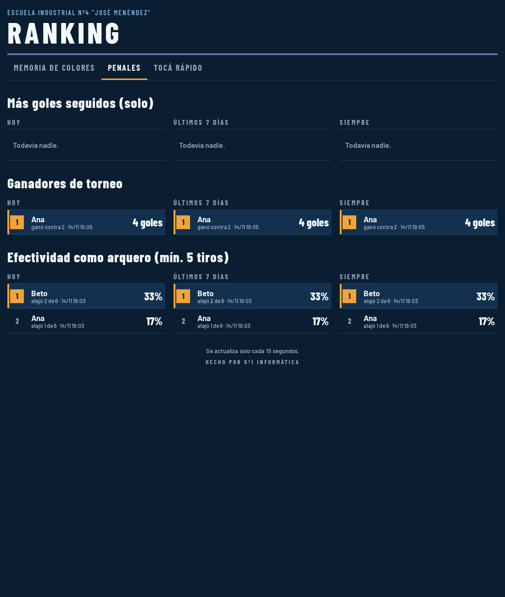

## 13. El diseño visual

Usamos el mismo estilo que el bowling, al que llamamos «**Institucional Nº4**»:

- **Colores:** azul noche de fondo (`#0B1D30`), el azul (`#6272B4`) y el celeste (`#7AB6E6`) del logo como acentos, y naranja (`#F2A33A`) solo para lo que hay que destacar: lo elegido, los récords, el reloj en los últimos segundos.
- **Tipografías:** Barlow para los textos y Barlow Condensed, en mayúsculas y con letras espaciadas, para los títulos.
- **Logo:** el emblema de la escuela, redibujado en vector a partir del logo del sitio oficial. Está en el menú, en el celu, en el encabezado de cada juego y en los carteles de la cancha.
- **Recursos que repetimos en todo:** la línea azul bajo el encabezado, las fichas de jugador con una barra de su color a la izquierda, los cuadrados de oro, plata y bronce en el ranking, y la cinta naranja de «Nuevo récord de la escuela».
- **Lo que evitamos:** brillos tipo neón, degradados y tarjetas redondeadas genéricas.

| Resultados | Memoria, eliminación con 3 celus | Penales, torneo |
|---|---|---|
| 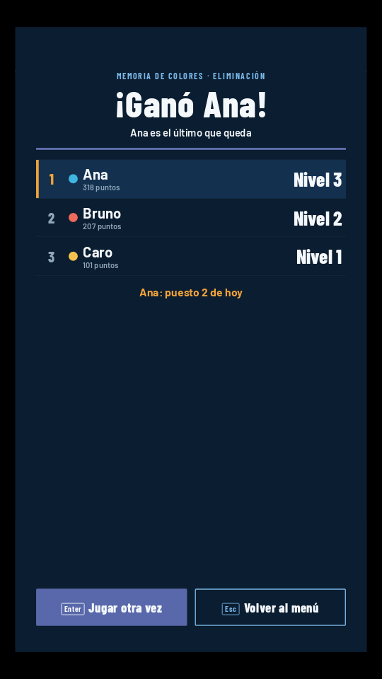 | 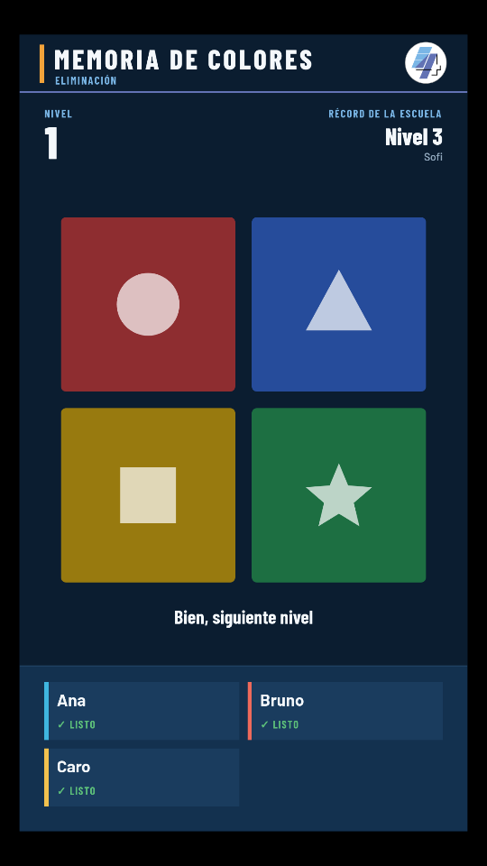 | 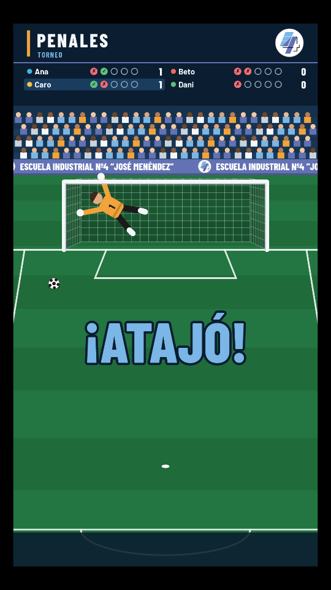 |

## 14. Pruebas y calidad

Probamos todo con **pruebas automáticas**, para no tener que probar a mano cada cambio:

- **38 pruebas unitarias** (`npm test`, con `node:test`) sobre:
  - las reglas de Memoria: niveles, secuencias, mezcla, puntaje y cooperativo;
  - las reglas de Penales: del trazo al tiro, gol, palo, golazo, el arquero y el 1 contra 1;
  - el ranking;
  - el servidor: sala, reconexión, validaciones y mensajes con datos rotos.
- **Pruebas con navegadores reales** (Playwright). Abren la tele en 1080 × 1920 y varios celulares emulados, y juegan solas:
  - Memoria: tres niveles con el teclado, y una eliminación en la que un jugador acierta, otro se equivoca en el nivel 3 y otro se desconecta.
  - Penales: tiros con el mouse, un 1 contra 1 hasta la muerte súbita, y un torneo de 4.
  - Cada prueba saca capturas de pantalla: las de este documento salieron de ahí.
- **La prueba final** (`npm run prueba:final`) juega todos los modos de todos los juegos hasta el final y comprueba que:
  - un celu que se desconecta y vuelve recupera su lugar;
  - los puntajes siguen ahí después de **reiniciar el servidor**;
  - con la pantalla girada 90°, los clics caen bien;
  - **ninguna página pide nada a internet** y no hay errores en la consola.

## 15. Diferencias con el Bowling Tótem

| | Bowling Tótem | Juegos en la tele |
|---|---|---|
| Pantalla | Tótem vertical | Tele vertical por HDMI, no táctil |
| Juegos | Uno solo | Una plataforma con tres juegos que se enchufan |
| Física | **Matter.js**, un motor de física 2D, para los choques de bola y pinos | Sin motor: la física de los penales es matemática nuestra, calibrada con una simulación |
| Controles del celu | Uno, hecho a medida para el bowling | Cuatro genéricos (botones, zonas, deslizar, espera) que cualquier juego puede pedir |
| Sin celular | — | Modo Solo con mouse y teclado, por si falla el wifi |
| Lógica en el servidor | Ninguna | La validación del cooperativo de Memoria |
| Reutilizado | — | Ranking, filtro de nombres, conexión y reconexión de celus, diseño, tipografías, logo, lanzadores |

## 16. Lo que aprendimos

- **Separar reglas y dibujo** nos dejó probar los juegos sin abrir ninguna pantalla, y reutilizar las mismas reglas en la tele, el servidor y la simulación.
- **Calibrar con números y no a ojo:** la simulación de 1000 tiros nos dijo exactamente cuánto ajustar al arquero.
- **La red no es instantánea:** para que varios celus jueguen juntos hubo que sincronizar relojes y ordenar los toques por la hora en que se hicieron, no por la hora en que llegaron.
- **Todo sin internet:** las tipografías, el QR, los sonidos y los dibujos los genera o los sirve la propia notebook, y una prueba automática revisa que ninguna página pida nada de afuera.
- **Las pruebas encuentran problemas reales:** el de la fuerza del trazo lo descubrimos gracias a las pruebas automáticas, y el arreglo también mejoró el juego con dedos de verdad.

## 17. Cómo se pone en marcha

1. Instalar Node.js 20 o superior y, la primera vez, ejecutar `npm install --omit=dev`.
2. Conectar la notebook y los celulares a la misma red wifi. Puede ser la zona wifi de un celu, aunque no tenga datos.
3. Doble clic en `iniciar.bat` (Windows) o `./iniciar.sh` (Linux): arranca el servidor y abre la tele en pantalla completa.
4. Los jugadores escanean el QR de la tele.

Los detalles (girar la pantalla, usar la tele como pantalla extendida, qué hacer si los celus no se conectan) están en el `README.md`.
